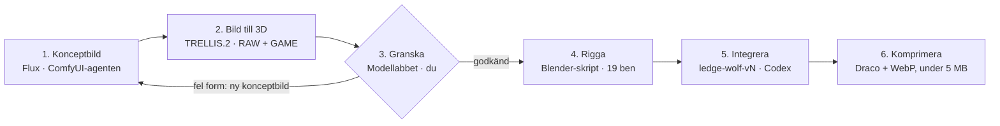

# Blackwood – arbetsflöde för 3D-modeller

2026-11-09 · Mats · Levande version: [Claude-dokument](https://claude.ai/artifact/8yjJZtJ9j8Pj7dPBqCSH3Z)

## Översikt

En ny eller förbättrad varulv går genom sex steg. ComfyUI-agenten gör steg 1–2, du granskar i steg 3, och Codex kör steg 4–6 i spelets repo.



Granskningen i steg 3 är grinden: en modell som ser fel ut i spelets ljus går tillbaka till en ny bild och riggas aldrig.

## Steg 1–2: koncept och 3D i ComfyUI

Bilden avgör nästan allt. En dålig konceptbild blir aldrig en bra modell, så lägg tiden här.

**Steg 1 – Konceptbild (Flux).** Kör workflowet `blackwood_werewolf_concept.json` via ComfyUI-agenten (del 2-prompten). Det ger 8 bilder per körning.

- Hela figuren syns, från huvud till fötter, och bara en figur.
- Neutral A-pose med armarna lite ut från kroppen, annars smälter armar och bål ihop i 3D.
- Rak framvy, slät ljusgrå bakgrund, platt studioljus utan skuggor.
- Varianter (Brute, Stalker, Alpha) byter bara beskrivningen av kroppen. Pose, bakgrund och ljus hålls lika.
- Välj 1–3 bilder. Kriterier: tydlig silhuett, separata armar, båda fötterna synliga, inga extra lemmar.

**Steg 2 – Bild till 3D (TRELLIS.2).** Kör `blackwood_werewolf_to_3d.json` på de valda bilderna, sedan `make_game_glb.sh`.

- Upplösning 512³ som standard. 1024³ bara i low-VRAM-läge och när detaljerna inte räcker.
- Resultat: en **RAW**-fil (2–3 miljoner trianglar, 250–350 MB) och en **GAME**-fil (ca 40 000 trianglar, ca 9 MB, 2,2 m hög).
- Räkna med 7–12 minuter per modell. UV-steget tar längst tid.
- Kontrollera agentens rapport: alla trianglar unika, rätt höjd, filstorlek under 15 MB och diagnosbilder där armar och ben finns kvar.
- Spara alltid RAW-filen. Den är originalet som allt annat kan göras om från.

### Projektion av konceptbilden på framsidan

Använd den frilagda konceptbilden och rikta in den mot GAME-modellen med en ortografisk kamera rakt framifrån. Passa in kameran efter silhuetten. Behåll GAME-modellens geometri, UV-koordinater, skala och origin genom färgbaket.

Projicera färgen till `baseColor` på de ytor som är synliga och vända mot kameran. Tona övergången vid bildens alfakant och mot sidorna. Baksidan behåller sin tidigare färg. Granska ansikte, bröst och övergångarna både framifrån och snett från sidan i modellabbet.

Använd projicerad `baseColor` tillsammans med `metallicRoughness` från den godkända diagnosfilen. **AO och normalkarta från TRELLIS-RAW används tills vidare inte.** GLB:n ska sakna både `occlusionTexture` och `normalTexture`. Normaldiagnosen för Batch 5 visade att normalkartan gav mörka fläckar och ränder även när den projicerade färgen var densamma. AO utelämnas också i den godkända varianten. För v3 används GLB-materialet direkt i spelets ljus, utan närbildsjusteringarna från v1 och v2.

Batch 5 v3 utgår från `3d/incoming/batch5-diag/20261110-134907/batch5_utan_ao_och_normal.glb`. Se [riggdiagnosen för v3](../art/creatures/batch5-v3-rig-report.md) för källan och kontrollen i testpos.

## Steg 3–4: granskning och riggning

Granska modellen i spelets ljus innan du riggar. Riggningen är det dyraste steget, så den ska bara göras på en modell du redan har godkänt.

**Steg 3 – Granska i modellabbet.** Kopiera GAME-filen till `3d/` i spelkatalogen, kör `npm run dev` i `web/` och öppna `http://localhost:5173/model-lab.html`.

- Nya filer i `3d/` dyker upp automatiskt bredvid den nuvarande vargen.
- Titta på alla tre platserna: i rummet, vid kanten och i skogen.
- Bedöm silhuett och proportioner i mörker och dimma, inte detaljer i närbild. Det är så spelaren ser den.
- Ser den fel ut: tillbaka till steg 1 med en ny bild. Att laga en dålig form senare kostar mer.

**Steg 4 – Rigga.** Kör riggningsskriptet i Blender (byggs av Codex, fas 1):

```
blender --background --python art/creatures/rig_generated_wolf.py -- <game.glb> <riggad.glb>
```

- Skriptet ger modellen spelets skelett med exakt 19 ben: `Pelvis`, `Chest`, `Head`, `Jaw`, `Tail` samt `Shoulder`, `Elbow`, `Wrist`, `Hip`, `Knee`, `Hock` och `Toes` med `.L`/`.R`. Fel namn betyder att spelet inte kan styra modellen.
- Vikterna räknas på en tät kopia (voxel remesh) och förs över till modellen, eftersom AI-modellerna har hål som får Blenders automatiska viktning att misslyckas.
- Granska diagnosbilderna: böjda armar och öppen käke ska ge mjuk deformation, inte veck eller spikar.
- Kontrollera proportionerna mot marionetten i `wolf.ts`. Avviker armar eller ben mer än några centimeter blir huden utdragen i spelet.

## Steg 5–6: in i spelet

En ny modell läggs alltid in bredvid den gamla, aldrig ovanpå. Då kan du jämföra i spelet och backa direkt om något går fel.

**Steg 5 – Integrera.**

- Lägg den riggade filen som `web/src/assets/werewolf/ledge-wolf-vN.glb` med nästa lediga versionsnummer.
- Koppla in den bakom `?wolf=vN` och jämför med föregående version via `?preview=ledge-wolf`.
- Byt standardversion först när den nya är godkänd i spelet.
- Spelet ska inte ändras i övrigt: träffytor, rörelser och balans kommer från marionetten.

**Steg 6 – Komprimera.** Kör `@gltf-transform/cli` med Draco för geometrin och WebP för texturerna.

- Mål: under 5 MB per modell. Cloudflares gräns är 25 MiB per fil.
- Jämför före och efter i modellabbet. Komprimerade texturer kan bli grötiga i närbild.

**Verifiera innan commit.**

- `npm run build` går igenom.
- Vargen ser rätt ut vid kanten, under utfallet och i attacken.
- Bildfrekvensen håller med 3–5 vargar samtidigt.
- `web/README.md` och `art/ART_CATALOG.md` anger källbild, seed, verktyg och licens.

## Förbättra en befintlig modell

Börja så sent i kedjan som möjligt. Det som ändras avgör vilket steg du går tillbaka till, och allt efter det steget körs om.

| Det du vill ändra | Börja om från | Varför |
| --- | --- | --- |
| Utseende i spelet: ljus, ögon, färgton, dimma | Steg 5 (bara kod) | Påverkar inte modellfilen |
| Filstorlek eller texturkvalitet | Steg 6 | Komprimeringen görs om från den riggade filen |
| Deformation: veck vid armbågar, käken sträcker ansiktet | Steg 4 | Benplacering eller vikter i riggningen |
| Proportioner mot marionetten | Steg 4 | Rigg eller marionettens mått justeras |
| Mer detalj, samma form | Steg 2 från RAW | Kör `make_game_glb.sh` igen, eller 1024³ från samma bild |
| Hål, trasig yta, saknade fingrar | Steg 2 | Ny 3D-körning, eventuellt högre upplösning |
| Form, pose, kroppstyp, ny varulvstyp | Steg 1 | Ny konceptbild |

Två regler gäller alltid:

- Skriv aldrig över en version. En förbättrad v2 blir v3, och v2 finns kvar tills v3 är godkänd i spelet.
- Ändringar som görs för hand i Blender efter riggningsskriptet försvinner nästa gång skriptet körs. Gör hellre ändringen i skriptet, eller spara den handredigerade filen som egen version.

## Regler, filer och checklista

**Licenser.** Spelet ska kunna publiceras, så varje verktyg i kedjan måste tillåta kommersiell användning i EU.

- TRELLIS.2 (MIT) och BiRefNet för bakgrundsborttagning är godkända.
- Hunyuan3D används inte: Tencents licens gäller inte i EU.
- RMBG-2.0 används inte: icke-kommersiell licens.
- Nya modeller eller verktyg: kontrollera licensen innan de används.

**Var filerna finns.**

| Fil | Plats | I Git |
| --- | --- | --- |
| Konceptbilder | `~/AI/ComfyUI/output/blackwood/concepts/` (WSL) | Nej |
| RAW- och GAME-modeller | `~/AI/ComfyUI/output/blackwood/models/` (WSL) | Nej |
| Kandidater för granskning | `3d/` i spelkatalogen | Nej |
| Riggningsskript | `art/creatures/rig_generated_wolf.py` | Ja |
| Riggad modell i spelet | `web/src/assets/werewolf/ledge-wolf-vN.glb` | Ja |

**Namngivning.** Genererade filer heter `<datum>_<seed>_batch<n>_{raw,game}.glb`. Seed och batchindex identifierar bilden, så de ska följa med hela vägen till `ART_CATALOG.md`.

**Checklista per modell.**

- [ ] Konceptbild vald: hel figur, A-pose, ren bakgrund
- [ ] GAME-fil klar: unika trianglar, 2,2 m, under 15 MB
- [ ] Godkänd i modellabbet i alla tre platser
- [ ] Riggad: 19 ben, diagnosbilder utan veck
- [ ] Proportioner stämmer mot marionetten
- [ ] Inlagd som ny version bakom `?wolf=vN`
- [ ] Komprimerad under 5 MB
- [ ] `npm run build` går igenom och bildfrekvensen håller
- [ ] Källa, seed och licens dokumenterade
- [ ] Ny standardversion vald
