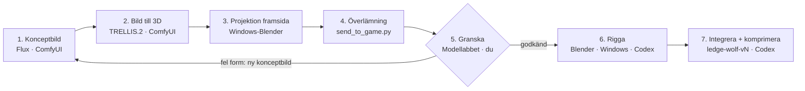

# Blackwood – arbetsflöde för 3D-modeller

Uppdaterad 2026-11-12 · Mats · Den här filen är huvudversionen. Claude-dokumentet [Blackwood – arbetsflöde för 3D-modeller](https://claude.ai/artifact/8yjJZtJ9j8Pj7dPBqCSH3Z) beskriver det första upplägget från 2026-11-09 och är inaktuellt.

## Översikt

En ny varulv tas fram i sju steg med Windows-native ComfyUI, Blender och Node. Codex använder den repolokala ingången `art/tools/blackwood.ps1`. Du väljer konceptbilder före 3D, godkänner kandidaten i Modellabbet före riggning och godkänner den nya versionen i spelet före standardbyte.



| Steg | Verktyg | Kommando |
|---|---|---|
| Konceptbild | ComfyUI + Flux | `concept` |
| Bild till 3D, sedan GAME | ComfyUI + TRELLIS.2 och Windows-Blender | `3d`, `game` |
| Frontprojektion | Windows-Blender | `project` |
| Överlämning | `art/tools/send_to_game.py` | `handoff` |
| Granskning i spelets ljus | Modellabbet | `lab` |
| Riggning mot spelets 19 ben | Blender och `rig_generated_wolf.py` | `rig` |
| Ny version, Draco och WebP | glTF Transform, Three.js | `compress`, `build` |

**Grundprincip:** varulven behöver bara vara detaljerad **i närbild uppe i grottan, och bara framifrån**. I skogen och under klättringen visar spelet den enkla procedurella vargen. Därför räcker det att framsidan har Flux-kvalitet. Baksida, sidor och nätets topologi behöver inte vara rena.

Granskningen i steg 5 är grinden: en modell som ser fel ut i spelets ljus går tillbaka till en ny bild och riggas aldrig.

## Start och status

**GPU-regel.** RTX 4090 används där steget har en GPU-variant. GPU-stegen avbryts med ett tydligt fel om rätt enhet saknas. En CPU-väg som ersätter ett GPU-steg kräver Mats godkännande. Blender rapporterar OptiX eller CUDA och aktiverar bara RTX 4090 i Cycles. CuMesh används för förenkling och remesh när paketet finns i TRELLIS-Python. När paketet saknas rapporteras Blender-meshsteget som `CPU (ingen GPU-variant)`. Riggvikter, komprimering och filkontroller rapporterar också CPU där de saknar en GPU-variant.

Kör i PowerShell 7 från reporoten. Från en annan arbetskatalog kan du anropa samma skript med dess absoluta sökväg. Relativa indatafiler som du anger tolkas från arbetskatalogen vid anropet.

```powershell
./art/tools/blackwood.ps1 init
./art/tools/blackwood.ps1 doctor
./art/tools/blackwood.ps1 --help
```

`init` skapar vid behov en ignorerad kopia av exempelkonfigurationen. `doctor` verifierar RTX 4090 med `nvidia-smi`, Torch CUDA i ComfyUI-Python, serverns CUDA-enhet och avsaknad av `--cpu` i `/system_stats` samt Cycles OptiX/CUDA via Blender i bakgrundsläge. `doctor --offline` kontrollerar bara filer. Konfigurationsfälten finns i [migrationsrapporten](MODEL_PIPELINE_MIGRATION.md). Se `<kommando> --help` för argument. `npm run pipeline -- doctor` från `web/` är ett alias när npm finns tillgängligt.

På den här maskinen ligger Node LTS med npm, Blender 4.2.9 och glTF Transform 4.5.1 under `E:\AI-Native\tools\`. Båda varianterna av `doctor` varnar för programvägar i `WindowsApps` och `Documents\Codex`.

Varje modellkörning, inklusive `concept --preset concept-photo`, skriver en egen JSON-körningsrapport i `build/blackwood/run-reports/`. Rapporten innehåller tidsstämplar, status och kommandots resultat eller felmeddelande. Sökvägen skrivs ut som `run_report` på stderr. Rapporterna per modellsteg finns också kvar i körningsmapparna.

Jobbrapporterna anger `device`. Flux och TRELLIS rapporterar den högsta samplade totala VRAM-användningen på kortet som `vram_peak_mib`, med omfattning i `vram_peak_scope`. En återupptagen övervakning kan bara mäta återstående del av körningen. TRELLIS-workern verifieras och anges separat i rapporten om grafen kräver en worker. Förhandsbilder renderas i Cycles på RTX 4090.

`blackwood.ps1 test` kör de isolerade repotesterna. Kör `art/tools/test_project_cuda.py` med den konfigurerade ComfyUI-Python för liveprov av CUDA-inpassning, synlighet och delade texlar. Testet kör inga modelljobb.

Använd `--approved` först när användaren godkänt stegets körning och eventuella skrivningar till den externa körningsytan. `comfy-start --approved` återanvänder en svarande ComfyUI eller kör den befintliga manuella launchern i ett separat PowerShell-förgrundsanrop. Start och körning godkänns enligt uppdragets omfattning. Publicering i Modellabbet är en granskningskandidat.

## Steg 1–2: koncept och 3D i ComfyUI

Bilden avgör nästan allt. Ansiktet i bilden blir modellens ansikte i närbild, så lägg tiden här.

**Steg 1 – Konceptbild (Flux).** `concept` använder FLUX.1 dev med FP8-viktdtyp, FP8-T5, CLIP-L, AE och XLabs Realism-LoRA (modell 1,0, CLIP 0,0). FluxGuidance är 3,5 och KSampler kör Euler/simple med CFG 1,0 i 28 steg. Både standarden och det alternativa kommandot `concept-schnell` ger 8 bilder i 1024×1536. Körnings-ID, seed, batchindex och SHA-256 följer med i rapporten. [Workflow-källor och modellkrav](../art/comfyui/README.md)

`concept --preset concept-photo --run concept-photo-20261113 --seed 2685697290443443 --approved` använder samma FLUX.1 dev-inställningar med en fast prompt för praktiska filmeffekter och studiofotografi. Utelämna `--body` för fotopresetet.

För kontrollerade jämförelser kan `3d --bf16 --raw-only` använda Comfy-Orgs okvantiserade BF16-vikt vid 512. Kör int8 och BF16 med separata körnings-ID:n och samma konceptbild och seed. `game --remesh` bygger ett slutet 4 mm-voxelskal före förenkling och färgbakning. `game --save-bake-mask` sparar träffmasken från Cycles, och `project --bake-mask <png>` fyller tomma texlar med närmaste giltiga färg inom samma UV-ö före och efter projektionen. Använd masken från exakt den GAME-fil som projiceras. Projektionsandelen räknar RGB-ändringar från själva projektionen. `project --face-preview` ger en ansiktsbild vid sidan av front och oblique30.

```powershell
./art/tools/blackwood.ps1 concept --run stalker-01 --seed 2685697290443443 --body 'Lean stalker with long limbs' --approved
```

- Hela figuren syns, från huvud till fötter, och bara en figur.
- Neutral A-pose med armarna lite ut från kroppen, annars smälter armar och bål ihop i 3D.
- Rak framvy, slät ljusgrå bakgrund, platt studioljus utan skuggor.
- **Huvudet måste läsas som varg rakt framifrån:** lång nos, smala spetsiga öron, synliga tänder. TRELLIS.2 ser bara framvyn och gissar resten. Batch 5 fick kort nos och breda fladdermusöron.
- Varianter (Brute, Stalker, Alpha) byter bara beskrivningen av kroppen. Pose, bakgrund och ljus hålls lika.
- Välj 1–3 bilder. Kriterier: tydlig silhuett, separata armar, båda fötterna synliga, tydligt varghuvud.

**Steg 2 – Bild till 3D (TRELLIS.2).** `blackwood_werewolf_to_3d.json` körs på uttryckligen valda batchindex och sparar också en frilagd PNG från BiRefNet för projektionen. Båda TRELLIS-presets använder PEC för UV-segmentering på ComfyUI:s GPU. `3d` kör även RAW → GAME i Windows-Blender. `--raw-only` avslutar vid RAW. `game` kan återanvända en RAW från körningen, eller ta en befintlig fil via `--raw` tillsammans med dess `--seed`.

```powershell
./art/tools/blackwood.ps1 3d --run stalker-01 --select 3 7 --approved
./art/tools/blackwood.ps1 game --run stalker-01 --batch 3 --approved
```

- Upplösning 512³ som standard. `3d --resolution 1024` väljer det separata kaskadpresetet. Kör det efter separat godkännande. Samma batch i en körning har ett jobb-ID och kan bara använda ett preset.
- Resultat: en **RAW**-fil (2–3 miljoner trianglar, 250–350 MB) och en **GAME**-fil (cirka 40 000 trianglar, cirka 9 MB, 2,2 m hög, origin mellan fötterna, Y upp, framåt +Z).
- Historiska körningar tog 7–12 minuter per modell. Tid och minneskrav för den nya pipelinen återstår att mäta.
- GAME svetsar sammanfallande punkter på en arbetskopia före collapse. Den vägen väljs när trianglarna är unika, triangelantalet är nära 40 000, armarnas, fötternas och huvudets ytterlägen avviker högst 2 % av RAW-höjden och silhuettens IoU är minst 0,95 både framifrån och från sidan i samma kameraram.
- Före GLB-export jämnar Blender ut normalerna över sammanhängande kanter under 80°. Brantare kanter och kanter som saknar två angränsande ytor förblir skarpa.
- GAME och projektion varnar vid mindre än 50 % summerad UV-yta, median under 20 px² per triangel vid 2048², mer än 1 % trianglar under 1 px² eller fler än 300 sammanhängande UV-öar. Saknad eller ogiltig UV och en atlas där alla UV-trianglar saknar yta stoppar körningen. När CuMesh finns kan GAME använda xatlas för att skapa och packa öarna på CPU. Texturen bakas med Cycles på GPU.
- En separat Windows-installation av CuMesh kan anges med `cumesh_site_packages` i den lokala konfigurationen. GAME laddar den i `trellis_worker_python` eller, om den saknas, i `comfy_python`. Windows-paketet för Python 3.12, Torch 2.11 och CUDA 13.0 är verifierat på RTX 4090. [Publicerad Windows-version och SHA-256](https://github.com/PozzettiAndrea/cuda-wheels/releases/expanded_assets/cumesh-latest).
- Vid missad kontroll svetsas en ny arbetskopia och byggs om till ett slutet yttre skal. Adaptern använder CuMesh kring upplösning 512 när det finns i TRELLIS-Python med CUDA. Annars används Windows-Blenders voxel-remesh med cirka 4 mm voxel. Efter borttagning av inre och lösa komponenter förenklas skalet mot 40 000 trianglar. Blender gör en ny Smart UV-atlas och bakar RAW:s diffusa färg med selected-to-active och en kort cage/räckvidd. Cycles använder en tillgänglig GPU-backend i första hand och anger vald enhet i rapporten.
- Rapporten visar vald väg, collapse-resultat, slutresultat och förhandsbilder framifrån, från sidan och bakifrån. Bedöm eventuella kvarstående avvikelser mot RAW före godkännande.
- Bevara RAW-filen oförändrad i körningen. Vid timeout läser samma kommando och körnings-ID exakt jobbets historik. Ett okänt utfall kräver granskning av jobb-ID och intent före beslut om en ny körning.

## Steg 3–4: projektion och överlämning

**Steg 3 – Projicera konceptbilden på framsidan.** `project` använder körningens GAME och den hashade frilagda PNG-filen från samma 3D-jobb. För en befintlig GAME-fil används `--game`, dess `--seed` och den matchande frilagda bilden via `--image`.

```powershell
./art/tools/blackwood.ps1 project --run stalker-01 --batch 3 --approved
```

En ortografisk kamera framifrån (+Z) optimerar en enhetlig skala och förskjutning i x och y genom att maximera IoU mellan alfamasken och modellens framsilhuett. PyTorch på CUDA gör silhuettinpassning, djuptest, UV-rastrering och utfyllnad. Rapporten anger IoU och symmetriskt konturavstånd i pixlar (p95 och max), med varning under 0,80. Det historiska batch5-facitet rapporterade 0,8419 i full upplösning. Behåll GAME-modellens geometri, UV-koordinater, skala och origin.

Projektionen mäter andelen unika framåtvända atlastexlar vars exporterade RGB-färg ändras. Under 20 % stoppar steget. Från 20 % till under 50 % fortsätter steget med en varning. Rapporten anger antalet ändrade texlar, antalet framåtvända texlar och andelen. `atlas.png` visar den projicerade färgtexturen.

Projektionen skriver `baseColor` på ytor som klarar djuptestet och är vända mot kameran. Vinkeltoningen använder smoothstep av normal·kamera dividerat med 0,7 och alfakanten tonas över cirka 4 px. Delade texlar och baksidans täckta texlar behåller sin färg. Utfyllnaden når 16 px utanför UV-öarna. Granska ansikte, bröst och övergångarna både framifrån och snett från sidan.

Exportera med projicerad `baseColor` och `metallicRoughness`. **Ingen AO-karta och ingen normalkarta:** GLB:n ska sakna både `occlusionTexture` och `normalTexture` (se Erfarenheter nedan). Rensa oanvända bilder ur filen vid export.

**Steg 4 – Överlämning.** `3d` och `game` publicerar GAME som `game`, `project` publicerar som `projected` och `rig` publicerar som `rigged` efter att GLB, rapport och förhandsbilder har verifierats. Standardgruppen i Modellabbet är `werewolf`. Välj en annan grupp med `--lab-name`, hoppa över överlämningen för kommandot med `--no-lab` eller öppna kandidatens direktlänk med `--open`. RAW ligger kvar i körningsmappen på E:. Vid fel visar kommandot orsaken och länkar till en felrapport i `build/blackwood/`.

Överlämningen publicerar GLB, PNG-förhandsbilder och `report.json` atomärt i `3d/incoming/<namn>/<körning>/`. Mappnamnet innehåller batch och steg så att samma körnings GAME, projektion och rigg kan ligga bredvid varandra. `manifest.json` innehåller ursprungligt körnings-ID, steg, seed, batch, källhashar och tillgängliga mått för trianglar, höjd, IoU och enhet. `latest.json` pekar på senaste verifierade publicering. Identiska försök återanvänder befintliga filer. Ändrat innehåll på samma publiceringssökväg ger konflikt.

Använd `handoff` för att publicera en tidigare sparad batch. För en fristående kandidat anger du i stället `--candidate`, `--report` och `--preview` för varje PNG. Rapporten ska innehålla körnings-ID, kandidatens filnamn, roll och SHA-256. Med `--dry-run` valideras filerna utan publicering.

```powershell
./art/tools/blackwood.ps1 handoff --name werewolf --run batch5-flux-dev-20261112 --batch 2 --stage game
```

## Steg 5: granska i modellabbet (du)

Modellabbet är ett lokalt granskningsverktyg. En klon från GitHub innehåller pipelinen, förhandsbilderna som den kan generera och spelets modeller. Öppna förhandsbilderna från överlämningen om den lokala Modellabbsinstallationen saknas. Godkännande krävs fortfarande före riggning.

Kör `./art/tools/blackwood.ps1 lab` för att öppna Modellabbet på `http://localhost:5173/model-lab.html`. Kommandot återanvänder arbetskopians Vite-server om den redan svarar och startar annars utvecklingsservern i `web/` med konfigurerad Windows-Node. Efter en överlämning skriver pipelinen ut en direktlänk med `?model=<sökväg under 3d/>`.

- Modellabbet läser `/__models/index.json` var tredje sekund. Nya GLB-filer visas i den öppna fliken, märks **NY** och väljs automatiskt när du inte har gjort ett eget modellval de senaste 30 sekunderna. Modeller som redan har laddats återanvänds.
- Den nuvarande spelvargen ligger först. Kandidater grupperas per namn med de senaste överst. För den valda modellen visar panelen körning, steg, trianglar, höjd, tillgängliga IoU-värden och enhet.
- Modellabbet och dess index finns i utvecklingsservern. Produktionsbygget innehåller spelsidan, och `3d/` ligger utanför Git.
- Välj modell med 1–9, byt plats med P (rummet, kanten, skogen), dra för att titta, scrolla för att zooma, Q/E vrider modellen, H döljer panelen.
- **Bedöm i rummet, framifrån.** Det är där detaljen ska hålla.
- Svarta fläckar som bara syns i spelets ljus kan komma från AO- eller normalkartan.
- Ser formen fel ut: tillbaka till steg 1 med en ny bild.

## Steg 6–7: riggning och integration (Codex, Windows)

**Steg 6 – Rigga.**

```powershell
./art/tools/blackwood.ps1 rig --source '3d/incoming/stalker/stalker-01/seed-2685697290443443_batch3_baked.glb' --output 'build/stalker-rigged.glb' --fit-puppet --approved
```

- Skriptet ger modellen spelets skelett med exakt 19 ben: `Pelvis`, `Chest`, `Head`, `Jaw`, `Tail` samt `Shoulder`, `Elbow`, `Wrist`, `Hip`, `Knee`, `Hock` och `Toes` med `.L`/`.R`. Fel namn betyder att spelet inte kan styra modellen.
- `--fit-puppet` formar om modellen till marionettens proportioner i `wolf.ts`. Därför görs projektionen (steg 3) före riggningen.
- Vikterna räknas på en tät kopia (voxel remesh) och förs över till modellen, eftersom AI-modellerna har hål.
- Ledpositionerna i skriptet är mätta på batch 5. En ny modell med annan form kräver att de kontrolleras och vid behov mäts om.
- Granska diagnosbilderna: böjda armar och öppen käke ska ge mjuk deformation, inte veck eller spikar.

**Steg 7 – Integrera och komprimera.**

- Lägg den riggade filen som `web/src/assets/werewolf/ledge-wolf-vN.glb` med nästa lediga versionsnummer.
- Koppla in den bakom `?wolf=vN` och jämför med föregående version via `?preview=ledge-wolf`.
- Kör exempelvis `./art/tools/blackwood.ps1 compress --source 'build/stalker-rigged.glb' --version 4 --approved`. Den konfigurerade glTF Transform-installationen använder Draco för geometrin och WebP för texturerna. Mål under 5 MB per modell. Cloudflares gräns är 25 MiB per fil.
- För v3 och senare används GLB-materialet direkt i spelets ljus, utan närbildsjusteringarna från v1 och v2.
- Byt standardversion först när den nya är godkänd i spelet.
- Spelet ska inte ändras i övrigt: träffytor, rörelser och balans kommer från marionetten.

**Verifiera innan commit.**

- `./art/tools/blackwood.ps1 build` går igenom.
- Vargen ser rätt ut vid kanten, under utfallet och i attacken.
- Bildfrekvensen håller med 3–5 vargar samtidigt.
- `web/README.md` och `art/ART_CATALOG.md` anger källbild, seed, verktyg och licens.

## Nuvarande modell: batch 5 v3

Källa: `3d/incoming/batch5-diag/20261110-134907/batch5_utan_ao_och_normal.glb`, godkänd i modellabbet 2026-11-10. Projicerad färg från konceptbilden, ingen AO, ingen normalkarta. Se [riggdiagnosen för v3](../art/creatures/batch5-v3-rig-report.md) för kontrollen i testpose.

Kvar att förbättra: öronen (breda som en fladdermus) och nosen (kort i profil). Det kräver en ny konceptbild med tydligare varghuvud, eller handarbete i Blender.

## Erfarenheter: det här fungerade inte

| Försök | Resultat | Slutsats |
|---|---|---|
| Normalkarta och AO bakade från RAW | Svarta fläckar och ränder i spelet. RAW har inre lager och trasiga ytor | Används inte. Relief kommer från formen och den projicerade bilden |
| Städa nätet (voxel remesh, QuadriFlow, förenkling, shrinkwrap) | Sämre för varje försök: hundratals lösa delar, upp till 15 cm avvikelse | Behövs inte när bara framsidan syns i närbild |
| Hårda siffergränser som stoppade körningar | En visuellt bra bakning stoppades. Två dagar gick åt till att klara siffror | Gränser är varningar. Människan godkänner i modellabbet |
| Förenkla RAW direkt till budget | Armar och ben försvann trots rätt triangelantal | `make_game_glb` kontrollerar nu unika trianglar och form |

Om AI-vägen inte räcker för en modell: köp en färdig riggad modell eller låt en 3D-artist göra om nät, UV, texturer och päls i Blender. Riggningsskriptet, modellabbet och överlämningen fungerar även för sådana modeller.

## Förbättra en befintlig modell

Börja så sent i kedjan som möjligt. Det som ändras avgör vilket steg du går tillbaka till, och allt efter det steget körs om.

| Det du vill ändra | Börja om från | Varför |
| --- | --- | --- |
| Utseende i spelet: ljus, ögon, färgton, dimma | Steg 7 (bara kod) | Påverkar inte modellfilen |
| Filstorlek eller texturkvalitet | Steg 7 | Komprimeringen görs om från den riggade filen |
| Deformation: veck vid armbågar, käken sträcker ansiktet | Steg 6 | Benplacering eller vikter i riggningen |
| Proportioner mot marionetten | Steg 6 | Rigg eller marionettens mått justeras |
| Färg eller detalj på framsidan | Steg 3 | Ny projektion, samma modell |
| Mer detalj i formen | Steg 2 från RAW | `game` igen med ett nytt körnings-ID, eller 1024³ från samma bild efter verifiering |
| Form, ansikte, kroppstyp, ny varulvstyp | Steg 1 | Ny konceptbild |

Två regler gäller alltid:

- Skriv aldrig över en version. En förbättrad v3 blir v4, och v3 finns kvar tills v4 är godkänd i spelet.
- Ändringar som görs för hand i Blender efter riggningsskriptet försvinner nästa gång skriptet körs. Gör hellre ändringen i skriptet, eller spara den handredigerade filen som egen version.

## Regler, filer och checklista

**Licenser.** Spelets levererade material ska kunna publiceras kommersiellt i EU. För FLUX.1 dev använder Mats tolkningen att licensen medger kommersiell användning av genererade bilder enligt utdatareglerna. Modellen omfattas av separat icke-kommersiell licens. [FLUX.1 dev-licensen](https://huggingface.co/black-forest-labs/FLUX.1-dev/blob/main/LICENSE.md)

- TRELLIS.2 (MIT) och BiRefNet för bakgrundsborttagning är godkända.
- Hunyuan3D används inte: Tencents licens gäller inte i EU.
- RMBG-2.0 används inte: icke-kommersiell licens.
- Nya modeller eller verktyg: kontrollera licensen innan de används.

**Var filerna finns.**

| Fil | Plats | I Git |
| --- | --- | --- |
| Nya ComfyUI-workflows och bindningar | `art/comfyui/` | Ja |
| Konceptbilder och rapport | `<runs_root>/<run>/concepts/` | Nej |
| RAW, GAME och bakad modell | `<runs_root>/<run>/{raw,game,baked}/<batch>/` | Nej |
| Windows-program och arbetsyta | `art/tools/blackwood.config.local.json` anger de lokala vägarna | Nej |
| Överlämningsskript | `art/tools/send_to_game.py` | Ja |
| Överlämningar och kandidater | `3d/` i spelkatalogen | Nej |
| Modellabbet | `web/model-lab.html`, `web/src/model-lab.ts`, `web/vite.config.ts` | Nej |
| Riggningsskript | `art/creatures/rig_generated_wolf.py`, `ledge_skeleton.py` | Ja |
| Riggad modell i spelet | `web/src/assets/werewolf/ledge-wolf-vN.glb` | Ja |

**Namngivning.** Verktyget använder `seed-<seed>_batch<n>_<roll>` i körningsmappen. Seed och batchindex identifierar bilden och ska följa med till `ART_CATALOG.md`.

**Checklista per modell.**

- [ ] Konceptbild vald: hel figur, A-pose, ren bakgrund, tydligt varghuvud framifrån
- [ ] GAME-fil klar: unika trianglar, 2,2 m
- [ ] Framsidan projicerad, utan AO och normalkarta, oanvända bilder rensade
- [ ] Överlämnad med `send_to_game.py`
- [ ] Godkänd i modellabbet, i rummet framifrån
- [ ] Riggad: 19 ben, diagnosbilder utan veck
- [ ] Inlagd som ny version bakom `?wolf=vN`, komprimerad under 5 MB
- [ ] `./art/tools/blackwood.ps1 build` går igenom och bildfrekvensen håller
- [ ] Källa, seed och licens dokumenterade
- [ ] Ny standardversion vald
